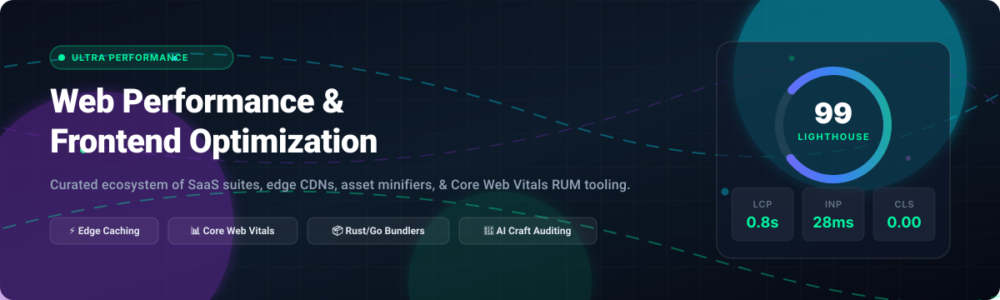

# ⚡ Awesome Web Performance & Frontend Optimization 🚀

  <strong>The definitive ecosystem index of high-performance SaaS platforms, edge CDNs, next-gen JavaScript/Rust bundlers, Core Web Vitals telemetry, and asset optimization tooling.</strong>

  
  
  
  
  
  

  <a href="#-sector-overview--market-dynamics">Sector Overview</a> •
  <a href="#-saashosted-platforms">SaaS &amp; Cloud Platforms</a> •
  <a href="#-open-source-github-projects">Open-Source Projects</a> •
  <a href="#-how-to-contribute">Contributing</a> •
  <a href="#-star-history">Star History</a> •
  <a href="#-support--sponsorship">Support</a>

---

## 🌐 Overview & SEO Keywords

Welcome to the **Awesome Web Performance & Frontend Optimization** repository. This resource covers full-stack web speed engineering: **Core Web Vitals (LCP, INP, CLS, TTFB, FCP)**, **Edge CDN Caching**, **Real User Monitoring (RUM)**, **Synthetic Page Speed Testing**, **Rust & Go Asset Bundlers**, **Critical CSS Extraction**, **AVIF / WebP Next-Gen Image Compression**, and **AI Coding Agent Frontend Auditing**.

Whether you are scaling sub-second latency for an enterprise e-commerce storefront or optimizing bundle sizes for modern Single Page Applications (SPAs) and Progressive Web Apps (PWAs), this guide benchmarks the leading commercial services and open-source tools.

---

## 📈 Sector Overview & Market Dynamics

The global web performance, application acceleration, and digital experience monitoring (DEM) market is estimated at **$7.5 billion in 2024–2025 and is projected to reach $15.8 billion by 2030**, compounding at an annual growth rate (CAGR) of ~14.2%. 

The sector exhibits **moderate consolidation at the edge network and infrastructure layer** (where hyper-scale cloud and CDN giants such as Cloudflare, Akamai, Fastly, and Google hold dominant market share through massive global point-of-presence networks), while remaining **highly fragmented and innovatively competitive across the diagnostic, RUM, synthetic testing, and frontend build optimization tiers** where specialized point solutions (DebugBear, SpeedCurve, Calibre, NitroPack) and rapid open-source innovations (Vite, Rolldown, SWC, Partytown, Impeccable) continuously emerge.

---

## 💼 SaaS/Hosted Platforms

The table below catalogs premier commercial web acceleration, Core Web Vitals RUM, image CDN, and synthetic monitoring suites. It is sorted descending by company scale (enterprise market capitalization, valuation, or annual revenue run-rate).

| Company / Product | Scale / Valuation / Revenue | Primary Focus & Capabilities | Pricing Starting Tier | Free Tier & Trial Limits |
| :--- | :--- | :--- | :--- | :--- |
| **[Google PageSpeed Insights](https://pagespeed.web.dev/)** | **~$2.1T Market Cap** (Alphabet Inc.) | Core Web Vitals auditing, Chrome UX Report (CrUX) field data & Lighthouse engine | **$0.00 / mo** (Public API is completely free) | **Forever free**: Unlimited web UI tests; API allows up to 25,000 queries per day |
| **[Cloudflare](https://www.cloudflare.com/)** | **~$35B Market Cap** (NYSE: NET) | Global Anycast CDN, Early Hints, Polish image compression, Argo Routing & Zaraz script manager | **$20.00 / mo** (Pro plan); Business at $200.00 / mo | **Forever free plan**: Unlimited bandwidth, global CDN caching, DDoS mitigation, and free SSL |
| **[Akamai Ion](https://www.akamai.com/products/ion)** | **~$15B Market Cap** (NASDAQ: AKAM) | Enterprise adaptive acceleration, machine learning route optimization & automated script execution | **$2,500.00 / mo** (Base enterprise contract tier) | **30-day free trial**: Includes up to 1 TB data transfer and access to Ion acceleration controls |
| **[Fastly](https://www.fastly.com/)** | **~$1.2B Market Cap** (NYSE: FSLY) | Edge cloud platform, instant purge cache (<150ms), VCL / Compute@Edge and Image Optimizer | **$50.00 / mo** (Starting package minimum commitment) | **Forever free tier**: $50.00/month of free usage credit across CDN and Compute edge services |
| **[Vercel Speed Insights](https://vercel.com/analytics)** | **~$3.25B Valuation** (Private Series D) | Real-visitor Core Web Vitals telemetry segmented by route, device score, and global geography | **$20.00 / member / mo** (Vercel Pro plan) | **Forever free Hobby plan**: Includes up to 10,000 Web Analytics & Speed Insights events / mo |
| **[Cloudinary](https://cloudinary.com/)** | **~$2.0B Valuation** (Private / Bootstrapped/PE) | Automated end-to-end cloud image & video transcoding, responsive breakpoints & edge AVIF/WebP | **$89.00 / mo** (Plus plan, billed annually) | **Forever free plan**: 25 credits/month (~25,000 transformations or 25 GB managed bandwidth) |
| **[NitroPack](https://nitropack.io/)** | **~$15M+ ARR** (Private, Scale-up) | Automated full-page cache, critical CSS generation, JS deferral, and WebP compression | **$21.00 / mo** (Lite plan, billed monthly) | **Forever free plan**: 1 website, up to 5,000 page views/month and 1 GB CDN bandwidth with badge |
| **[GTmetrix](https://gtmetrix.com/)** | **~$10M+ ARR** (Part of Carbon60) | Synthetic page load audits, waterfall breakdowns, Lighthouse reports, and worldwide testing nodes | **$5.00 / mo** (Solo plan, billed annually at $60/yr) | **Forever free Basic plan**: 1 URL monitored every day, up to 5 on-demand test runs per week |
| **[SpeedCurve](https://www.speedcurve.com/)** | **~$6M+ ARR** (Private, Independent) | Deep synthetic performance benchmarking & Real User Monitoring with JS long-task attribution | **$100.00 / mo** (Starting tier covering 10,000 synthetic checks or 1.2M RUM pageviews) | **30-day free trial**: Up to 3,000 synthetic tests and 300,000 RUM page views without credit card |
| **[DebugBear](https://www.debugbear.com/)** | **~$3M+ ARR** (Private, Independent) | Deep Core Web Vitals diagnostic engine, LCP element inspector, INP interaction breakdown & CrUX history | **$89.00 / mo** (Performance plan, billed monthly) | **14-day free trial**: Full access to synthetic test runs, automated alerts, and CrUX telemetry tracking |
| **[Calibre](https://calibreapp.com/)** | **~$2M+ ARR** (Private, Independent) | Automated pull-request performance budgets, Lighthouse scheduling, and third-party script monitoring | **$85.00 / mo** (Team plan, billed monthly) | **14-day free trial**: Full platform access, unlimited team seats, and continuous synthetic test runs |

---

## 🛠️ Open-Source GitHub Projects

Curated open-source projects for frontend compilation, bundle minification, media transcoding, and runtime performance tracking. Sorted descending by GitHub Stars_Counts.

| Repository | GitHub_Stars | Focus & Description |
| :--- | :--- | :--- |
| **[pbakaus/impeccable](https://github.com/pbakaus/impeccable)** |  | Design vocabulary, performance & frontend craft auditing skill for AI coding agents (Claude Code, Cursor, Codex). |
| **[vitejs/vite](https://github.com/vitejs/vite)** |  | Next-generation frontend build tool leveraging native ES modules and high-performance production bundling. |
| **[webpack/webpack](https://github.com/webpack/webpack)** |  | Pioneer flexible static module bundler for modern JavaScript applications with code-splitting and asset loading. |
| **[evanw/esbuild](https://github.com/evanw/esbuild)** |  | Extremely fast JavaScript and CSS bundler and minifier written in Go that compiles code 10–100x faster. |
| **[swc-project/swc](https://github.com/swc-project/swc)** |  | Super-fast Rust-based platform for compiling, bundling, and minifying modern JavaScript/TypeScript. |
| **[lovell/sharp](https://github.com/lovell/sharp)** |  | High-performance Node.js image processing library powered by libvips for converting images to AVIF and WebP. |
| **[GoogleChrome/lighthouse](https://github.com/GoogleChrome/lighthouse)** |  | Automated auditing engine for web page performance, Core Web Vitals, accessibility, SEO, and PWA metrics. |
| **[postcss/postcss](https://github.com/postcss/postcss)** |  | Tool for transforming CSS with JavaScript plugins, enabling autoprefixing, minification, and modern syntax. |
| **[rollup/rollup](https://github.com/rollup/rollup)** |  | Next-generation ES module bundler that compiles compact, efficient JavaScript libraries using tree-shaking. |
| **[aidenybai/million](https://github.com/aidenybai/million)** |  | Extremely fast, lightweight optimizing virtual DOM compiler that speeds up React component rendering. |
| **[google/brotli](https://github.com/google/brotli)** |  | Generic-purpose lossless compression algorithm delivering higher density compression than Gzip for web assets. |
| **[rolldown/rolldown](https://github.com/rolldown/rolldown)** |  | Fast Rust-based JavaScript/TypeScript bundler with Rollup-compatible APIs built as future bundler for Vite. |
| **[BuilderIO/partytown](https://github.com/BuilderIO/partytown)** |  | Relocates resource-heavy third-party scripts (Google Tag Manager, analytics) into a Web Worker to boost INP. |
| **[GoogleChrome/workbox](https://github.com/GoogleChrome/workbox)** |  | Production-ready JavaScript Service Worker libraries for offline caching and progressive web app acceleration. |
| **[GoogleChromeLabs/quicklink](https://github.com/GoogleChromeLabs/quicklink)** |  | Drops page navigation latency by prefetching viewport in-view links during idle browser cycles via requestIdleCallback. |
| **[imgproxy/imgproxy](https://github.com/imgproxy/imgproxy)** |  | Fast, secure standalone server written in Go for resizing, converting, and optimizing web images on the fly. |
| **[terser/terser](https://github.com/terser/terser)** |  | JavaScript parser, mangler, and compressor toolkit designed for ES6+ bundle minification. |
| **[GoogleChrome/web-vitals](https://github.com/GoogleChrome/web-vitals)** |  | Modular, zero-dependency 2KB library measuring all Core Web Vitals metrics on real users in production. |
| **[FullHuman/purgecss](https://github.com/FullHuman/purgecss)** |  | Removes unused CSS rules and dead stylesheet code by analyzing production HTML and JavaScript files. |
| **[parcel-bundler/lightningcss](https://github.com/parcel-bundler/lightningcss)** |  | Blazingly fast CSS parser, transformer, bundler, and minifier written in Rust. |
| **[GoogleChrome/lighthouse-ci](https://github.com/GoogleChrome/lighthouse-ci)** |  | Automated CI harness and dashboard server for asserting performance budgets on every pull request. |
| **[ai/size-limit](https://github.com/ai/size-limit)** |  | Performance budget calculator for JavaScript libraries computing download time and main-thread execution cost. |
| **[instantpage/instant.page](https://github.com/instantpage/instant.page)** |  | Makes website navigations feel instantaneous by preloading pages right before a user clicks on desktop/mobile. |
| **[sitespeedio/sitespeed.io](https://github.com/sitespeedio/sitespeed.io)** |  | Complete open-source performance testing suite combining Browsertime, WebPageTest, and Grafana dashboards. |
| **[harlan-zw/unlighthouse](https://github.com/harlan-zw/unlighthouse)** |  | Modern CLI tool and interactive web UI that crawls and runs Lighthouse audits across an entire domain in parallel. |
| **[varnishcache/varnish-cache](https://github.com/varnishcache/varnish-cache)** |  | High-performance HTTP accelerator and reverse proxy daemon caching API responses and dynamic web pages. |
| **[Catchpoint/WebPageTest](https://github.com/Catchpoint/WebPageTest)** |  | Open-source core engine for running deep browser waterfall tests, filmstrip timelines, and packet traceroutes. |
| **[AOMediaCodec/libavif](https://github.com/AOMediaCodec/libavif)** |  | Portable open-source library and encoder for AV1 Image File Format (AVIF) for lightweight web imagery. |
| **[danielroe/beasties](https://github.com/danielroe/beasties)** |  | Inlines critical above-the-fold CSS and defers the rest (continuation of GoogleChromeLabs Critters). |

---

## 🤝 How to Contribute

Contributions are welcome! Please follow these contribution guidelines:
1. Fork this repository and create a descriptive branch (e.g., `git checkout -b feat/add-new-tool`).
2. Verify that your proposed tool or project is actively maintained.
3. Keep descriptions concise, factual, and strictly focused on web performance.
4. Ensure entries match existing tabular conventions.
5. Submit a Pull Request with a clear summary of your additions.

---

## 📊 Star History

---

## 💖 Support & Sponsorship

Thank you for visiting and supporting the **Awesome Web Performance & Frontend Optimization** project! If you find this curated list valuable, please consider:
- ⭐ **Starring** the repository to support discovery on GitHub
- 🍴 **Forking** and contributing your favorite performance utilities
- 📣 **Sharing** with your fellow frontend engineers, SREs, and DevOps teams
- ☕ **Sponsoring** continued research and maintenance via the [GitHub Sponsor Dashboard](https://github.com/sponsors/ishandutta2007)

---

## ⚖️ Disclaimer

*All trademarks, logos, and brand names are the property of their respective owners. Company valuations, pricing tiers, and plan terms are subject to change by vendors.*
